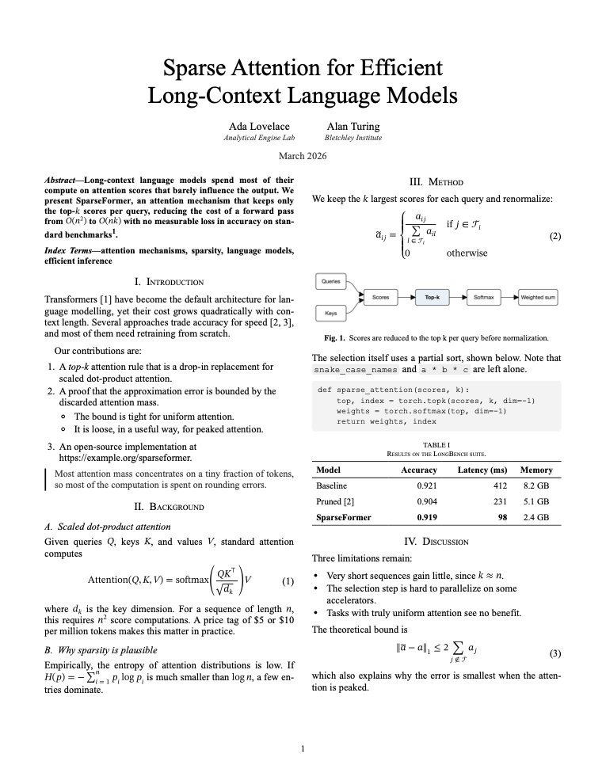
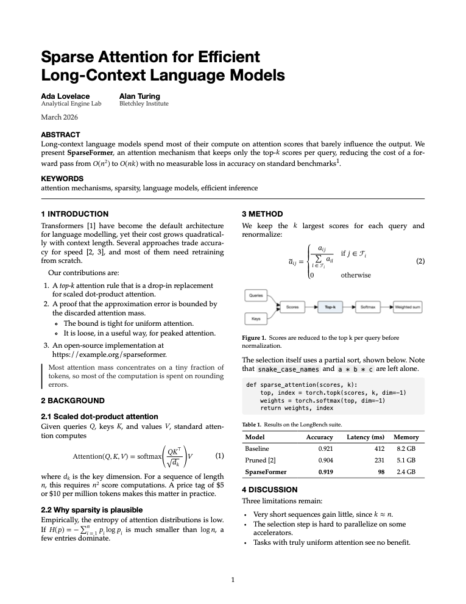
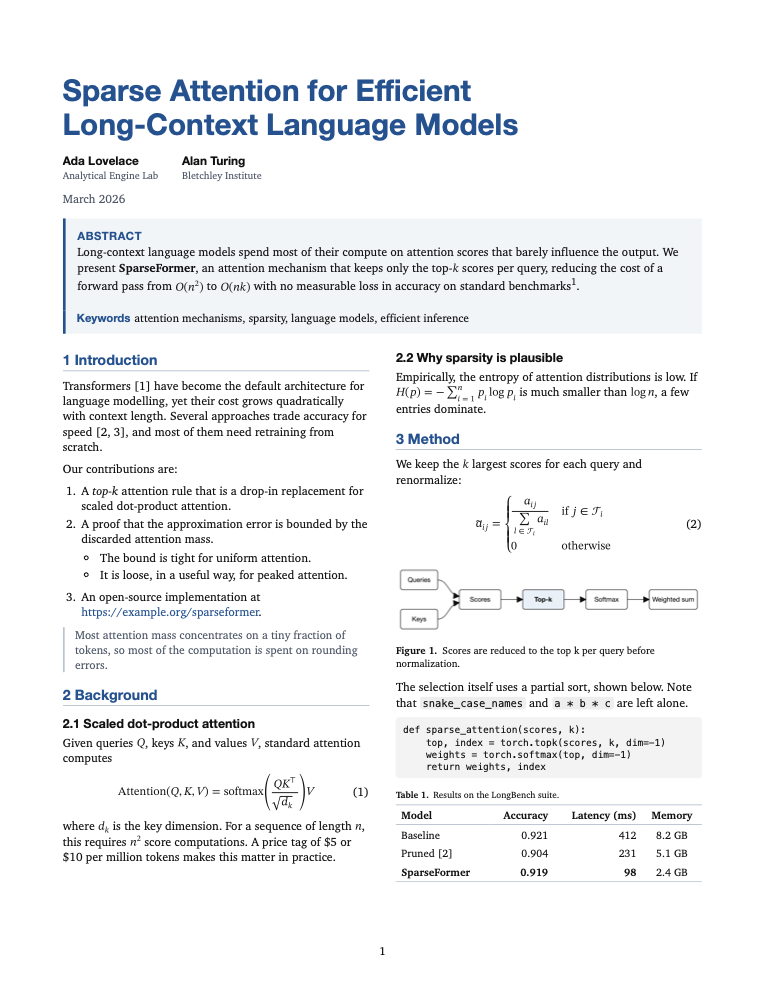
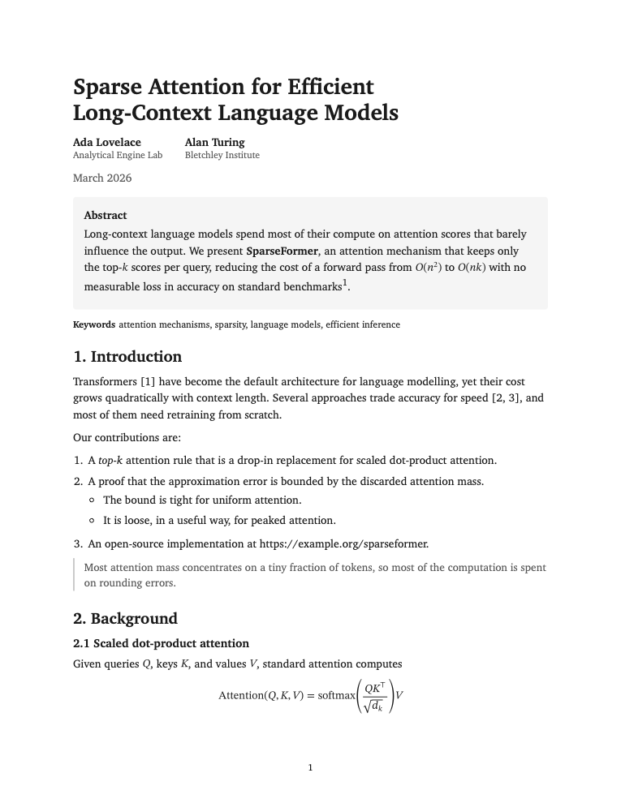
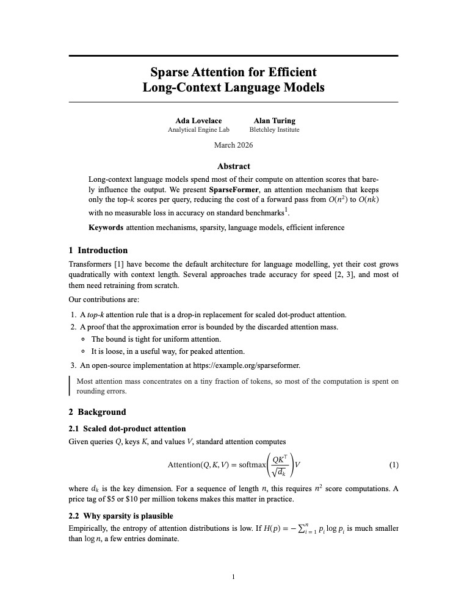
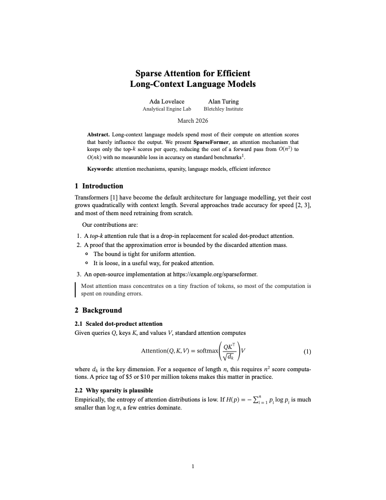
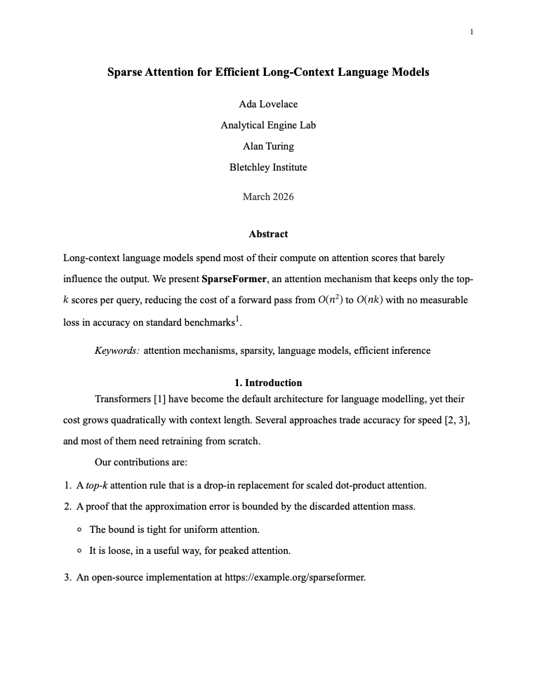
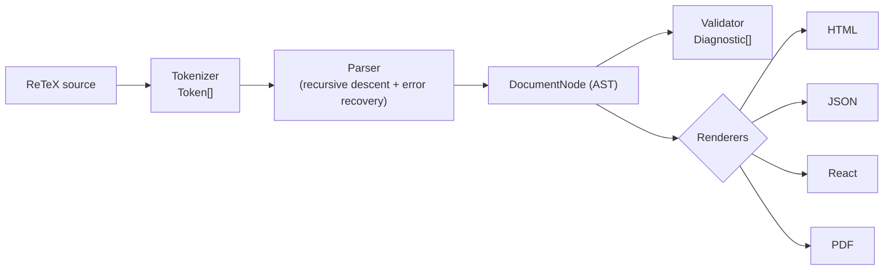

# ReTeX

**A modern, LaTeX-inspired markup language and compiler for research papers, resumes, and developer portfolios. Paste in Markdown from an AI model and get a typeset paper back.**

[](LICENSE)
[](https://www.typescriptlang.org/)
[](#zero-dependencies)

ReTeX (a.k.a. **ResumeTeX**) gives you the clean, declarative authoring feel of
LaTeX without the toolchain. You write a small, readable markup language; ReTeX
tokenizes, parses, validates, and renders it to **HTML**, **React**, **JSON**, or
**PDF** — all from a single, dependency-free TypeScript library.

ReTeX is **blank by default** — a plain, unstyled document, "just simple
editing". Styling is opt-in: import a **library** with `\usepackage{...}`
(LaTeX-style) for colors, fonts, shapes, or a full themed look. Nothing is
imposed; you add exactly what you want.

```latex
\name{Ada Lovelace}
\title{Software Engineer}
\email{ada@example.com}
\website{https://ada.dev}

\section{Experience}
\job{title=Senior Engineer, company=Analytical Engines, start=2021, end=Present}{
  Led the design of the first general-purpose compiler. Reduced build times by 40%.
}
```

---

## Markdown to research paper

Most AI models answer in Markdown. ReTeX turns that into a real paper, in two columns
or one, in the style you choose:

```bash
npx @regmisatyam/retex answer.md --style ieee -o paper.pdf

pbpaste | npx @regmisatyam/retex - --style acm -o paper.pdf   # straight from the clipboard
npx @regmisatyam/retex answer.md --style ieee -o paper.retex  # or as source to keep editing
```

```ts
import { markdownToHtml } from "@regmisatyam/retex";

const html = markdownToHtml(answer, { style: "ieee" });
const plain = markdownToHtml(answer); // the "normal" style: one clean column
const custom = markdownToHtml(answer, { style: "normal", columns: 2, pageSize: "A4" });
```

The same answer ([source](examples/ai-response.md)) in each style:

| `ieee` | `acm` | `journal` |
| --- | --- | --- |
| [](examples/rendered/ai-response-ieee.html) | [](examples/rendered/ai-response-acm.html) | [](examples/rendered/ai-response-journal.html) |

| `normal` | `arxiv` | `lncs` | `apa` |
| --- | --- | --- | --- |
| [](examples/rendered/ai-response-normal.html) | [](examples/rendered/ai-response-arxiv.html) | [](examples/rendered/ai-response-lncs.html) | [](examples/rendered/ai-response-apa.html) |

These reproduce the look of each family for reading and sharing. They are not the
publishers' official templates, which a venue may still require for submission.

Models rarely state a document's structure, so it is inferred:

- **The paper's parts.** A lone first heading becomes the title. `**Authors:**` lines,
  `## Abstract`, `**Keywords:**`, and `## References` become what they say. `[1]` in
  the text links to the reference it names.
- **Numbering.** Sections, figures, tables, and equations are numbered for you, and
  the `1.` in `## 1. Introduction` is removed so it doesn't come out as "I. 1. INTRODUCTION".
- **Math.** `$x^2$`, `\(x^2\)`, `$$…$$`, and `\[…\]` all work, compiled to native MathML with
  nothing to load. `$5 and $10` stays as prices.
- **Fit.** A table or equation too wide for its column spans the page rather than being
  cut off.
- **Cleanup.** "Sure! Here's your paper:", "Let me know if…", `【4†source】`, and emoji in
  headings are removed, and every removal is reported. `--keep-chatter` turns this off.

Try it live with `npm run playground`, and see **[the full guide](docs/MARKDOWN.md)**.

---

## Preview

The first three [examples](examples/) rendered to HTML. Each opts into a theme pack
with a single `\usepackage{...}` line (`modern`, `compact`, `classic`).
Regenerate with `npx tsx examples/build.ts`.

| Single column (`modern`) | Two column (`compact`) | Academic CV (`classic`) |
| --- | --- | --- |
| [](examples/software-engineer.retex) | [](examples/two-column.retex) | [](examples/research-paper.retex) |

---

## What ReTeX is — and is not

ReTeX **is** a focused markup language for *research papers and documents about
people and projects*: papers, résumés, CVs, academic bio pages, and developer
portfolios. It ships a curated set of commands (`\title`, `\author`, `\cite`, `\math`,
`\job`, `\education`, `\section`, …), strong theming, and four production-ready
renderers.

ReTeX **is not** a full LaTeX implementation. There is no macro programming and no
`\def`, and math is the common subset rather than all of TeX. The syntax is
*LaTeX-inspired* — familiar braces and backslash commands — but the language is
deliberately small, safe, and predictable. (Notably, `%` is a literal percent sign,
not a comment, and `$` is a literal dollar sign, not math;
see [Syntax](docs/SYNTAX.md).)

It does, however, borrow LaTeX's best idea: **packages**. The core is blank, and
you `\usepackage{...}` exactly the styling you need — `colors`, `fonts`,
`shapes`, or a complete theme pack like `modern`. See [Libraries](#libraries).

---

## Features

- **Markdown to paper** — convert Markdown, including AI answers, into a paper in any
  style. See [the guide](docs/MARKDOWN.md).
- **Paper styles** — `normal`, `ieee`, `acm`, `journal`, `arxiv`, `lncs`, `apa`, chosen
  with `\documentclass{...}` and adjustable with flags like `[onecolumn, a4paper]`.
- **Paper commands** — `\title`, `\author`, `abstract`, `\keywords`, `equation`, `\math`,
  `table`, `figure`, `code`, `quote`, `\footnote`, `\cite`, `references`, and automatic
  numbering of sections, figures, tables, and equations.
- **Math with no dependencies** — TeX compiles to native MathML, which every current
  browser renders.
- **Command line** — `retex paper.md --style ieee -o paper.pdf`.
- **Blank by default** — the core ships structure + basic emphasis; everything
  decorative is opt-in. A document with no imports renders as a clean,
  browser-default page.
- **Core typography** — `\textbf`, `\textit`, `\emph`, `\underline`, `\sout`,
  `\bfseries`, `\itshape`, and `\text[…]{…}` to **combine** styles in one go,
  e.g. `\text[bold, italic]{Hello}` (aliases: `b`, `i`, `u`, `s`).
- **Libraries (`\usepackage`)** — opt into styling, LaTeX-style: `colors`
  (`\textcolor`, `\themecolor`), `fonts` (`\fontfamily`, `\fontsize`,
  `\small`…`\Huge`, `\ttfamily`), `shapes` (`\hrule`, `\dashrule`, …, `\vspace`,
  `\hspace`), and theme packs `modern` / `classic` / `compact`. Activate from the
  document **or** from code (`engine.use(...)`).
- **Hyperlinks** — `\href{url}{label}` and `\url{url}`, with URL sanitization.
- **Sections** — `\section` and `\subsection`.
- **Résumé components** — `\name`, `\title`, `\email`, `\phone`, `\location`,
  `\website`, and rich entries `\job`, `\education`, `\project`, `\skills`.
- **Lists & layout** — `itemize`, `enumerate`, and a flexible `columns`
  environment.
- **Icons (opt-in)** — inline SVG icon set via `\icon{github}` or the
  per-icon shortcut `\github-icon{}`. Contact fields show **no** icon by
  default; use the `-icon` variant (`\email-icon{…}`, `\phone-icon{…}`,
  `\location-icon{…}`, `\website-icon{…}`) when you want the glyph. Extensible
  at runtime.
- **Theming** — a blank default plus opt-in presets (`modern`, `classic`,
  `compact`) and a fully data-driven, deep-mergeable custom theme model.
- **Plugins** — register new commands, environments, icons, renderers, or theme
  patches on a per-engine basis. Two example plugins ship in the box
  (`badgePlugin`, `ratingPlugin`).
- **Four renderers** — HTML fragments and full documents, a framework-agnostic
  React element tree, a structured JSON AST, and print-ready HTML/PDF.
- **Editor tooling** — completion, hover docs, semantic tokens, diagnostics,
  formatting, and AST inspection via `EditorService`.
- **Two-way preview** — opt-in `sourceMap` HTML stamps elements with source
  offsets so a live editor can sync both ways (click preview ↔ highlight code),
  Overleaf-style. See [`examples/playground.html`](examples/playground.html).
- **Incremental parsing** — block-level caching for fast live preview.
- **Security** — every text node and attribute is escaped; every URL is vetted.
  No `eval`, no `Function`, no code execution of source.
- <a name="zero-dependencies"></a>**Zero runtime dependencies.** React and
  Puppeteer are *optional* peers used only if you opt into React/PDF output.

---

## Install

```bash
npm i @regmisatyam/retex
```

React is an **optional peer dependency** — install it only if you use the React
renderer:

```bash
npm install react
```

PDF export lazily imports `puppeteer` if present; otherwise you can supply your
own headless-browser launcher (Playwright, a pooled Chromium, etc.) or print the
generated HTML to PDF in the browser.

The package includes a `retex` command, so `npx @regmisatyam/retex --help` works
without installing anything. Its PDF output uses any Chrome, Edge, or Chromium you
already have.

The package exposes three entry points:

| Import path                  | Contents                                              |
| ---------------------------- | ----------------------------------------------------- |
| `@regmisatyam/retex`         | The engine, pipeline, AST utilities, all renderers\*, theming, libraries\*\*, plugins, security, icons, editor, incremental compiler. |
| `@regmisatyam/retex/react`   | The React renderer (`ReactRenderer`, `renderReact`).  |
| `@regmisatyam/retex/library` | Just the libraries (`colorsLibrary`, `fontsLibrary`, …) and helpers. |

\* The React renderer is also re-exported from `@regmisatyam/retex`, but lives behind
`@regmisatyam/retex/react` so the core bundle never imports React.

\*\* The libraries are also re-exported from `@regmisatyam/retex`; the
`/library` subpath just lets you import them on their own.

---

## Quick start

```ts
import { ReTeXEngine } from "@regmisatyam/retex";

const engine = new ReTeXEngine();

const source = String.raw`
\name{Ada Lovelace}
\title{Software Engineer}
\email{ada@example.com}

\section{Experience}
\job{title=Senior Engineer, company=Analytical Engines, start=2021, end=Present}{
  Designed the first general-purpose compiler.
}
`;

// A clean HTML fragment:
const html = engine.toHtml(source);

// …or a complete, styled, standalone page:
const page = engine.toHtmlDocument(source, { title: "Ada Lovelace — Résumé" });

// The stylesheet for the active theme, if you render the fragment yourself:
const css = engine.styles();
```

`engine.toHtml` accepts either a source string or a parsed `DocumentNode`, so you
can parse once and render to several targets.

That document renders as a clean, **unstyled** page. To add styling, import a
library — from the source:

```latex
\usepackage{modern}        %% a full themed look + the color/font/shape commands
\textcolor{#7c3aed}{Now in color}
```

…or from code:

```ts
import { ReTeXEngine, colorsLibrary, fontsLibrary } from "@regmisatyam/retex";
const engine = new ReTeXEngine().use(colorsLibrary).use(fontsLibrary);
```

See [Libraries](#libraries) for the full catalog.

---

## A realistic résumé

```latex
\usepackage{modern}   %% styled look + color/font/shape commands (e.g. \hspace below)

%% --- header ---
\name{Grace Hopper}
\title{Distinguished Engineer \& Compiler Pioneer}
\email-icon{grace@example.com}   %% `-icon` variant prepends the glyph; plain \email{…} shows none
\phone-icon{+1 (555) 010-1999}
\location-icon{Arlington, VA}
\website-icon{https://gracehopper.dev}

\section{Summary}
Systems engineer with 30+ years building compilers and developer tools.
Coined the term \emph{debugging}. Reduced batch latency by 60%.

\section{Experience}
\job{title=Distinguished Engineer, company=US Navy, location=Washington, DC, start=1959, end=1986}{
  \begin{itemize}
    \item Led development of \textbf{COBOL}, the first English-like programming language.
    \item Built the first compiler, \textbf{A-0}, decades ahead of its time.
  \end{itemize}
}

\job{title=Senior Mathematician, company=Eckert--Mauchly, start=1949, end=1959}{
  Programmed the UNIVAC I; pioneered machine-independent programming.
}

\section{Education}
\education{school=Yale University, degree=PhD Mathematics, start=1930, end=1934}
\education{school=Vassar College, degree=BA Mathematics \& Physics, end=1928}

\section{Skills}
\skills{Compilers, COBOL, Systems Programming, Mentorship, Public Speaking}

\section{Links}
\icon{github} \href{https://github.com/gracehopper}{github.com/gracehopper}
\hspace{1em}
\icon{linkedin} \href{https://linkedin.com/in/gracehopper}{LinkedIn}
```

See the full language reference in **[docs/SYNTAX.md](docs/SYNTAX.md)**.

---

## Compiler pipeline

ReTeX is a real compiler with four well-separated stages. Each stage is pure,
never throws, and threads precise source ranges through so diagnostics map back
to the exact bytes the author typed.

```
  ReTeX source
       │
       ▼
┌──────────────┐   tokens      ┌──────────────┐   AST        ┌──────────────┐   diagnostics   ┌──────────────┐
│  Tokenizer   │ ────────────▶ │   Parser     │ ───────────▶ │  Validator   │ ──────────────▶ │  Renderers   │
│  (lexer)     │               │ (recursive   │              │ (semantic    │                 │ HTML / React │
│              │               │  descent +   │              │  checks)     │                 │ JSON / PDF   │
│              │               │  recovery)   │              │              │                 │              │
└──────────────┘               └──────────────┘              └──────────────┘                 └──────────────┘
       │                              │                              │                                │
   Token[]                      DocumentNode                  Diagnostic[]                    string / element /
                                                                                              JSON / Uint8Array
```



- **Tokenizer** — `tokenize(source)` → `{ tokens, diagnostics }`. Permissive,
  never throws. Handles ReTeX's resume-friendly lexing (`%` literal, `%%`
  comments, escapes, `\\` line breaks, blank-line paragraph breaks).
- **Parser** — recursive-descent, fully error-recovering. Consults the
  **command registry** for argument signatures and AST builders, handles scoped
  font switches and `\begin…\end` environments, and emits "did you mean?"
  suggestions for unknown commands.
- **Validator** — semantic checks over the AST (empty sections, stray `\item`,
  unknown theme colors, …). Pure and optional.
- **Renderers** — share structuring helpers (`toRegions`, `splitPreamble`,
  `entryParts`) so every target produces the same logical layout.

Read the deep dive in **[docs/ARCHITECTURE.md](docs/ARCHITECTURE.md)**.

---

## Rendering

### HTML

```ts
const engine = new ReTeXEngine();

engine.toHtml(source);                       // fragment: <div class="retex-resume">…</div>
engine.toHtmlDocument(source, { title: "CV" }); // full <!DOCTYPE html> page with <style>
engine.styles();                             // the theme's CSS (for the fragment case)
```

Or use the stage functions directly:

```ts
import { tokenize, parse, validate, renderHtml } from "@regmisatyam/retex";

const { ast } = parse(tokenize(source).tokens);
const diagnostics = validate(ast);
const html = renderHtml(ast, { classPrefix: "cv" });
```

### React

The React renderer has **no hard dependency on React** — you pass the JSX
factory yourself, so it works with React, Preact, or any compatible runtime.

```tsx
import React from "react";
import { ReTeXEngine } from "@regmisatyam/retex";

function Resume({ source }: { source: string }) {
  const engine = React.useMemo(() => new ReTeXEngine(), []);
  const tree = engine.toReact(source, {
    createElement: React.createElement,
    Fragment: React.Fragment,
  });
  return (
    <>
      <style>{engine.styles()}</style>
      {tree as React.ReactNode}
    </>
  );
}
```

Standalone, via the dedicated subpath:

```tsx
import React from "react";
import { renderReact } from "@regmisatyam/retex/react";
import { parse, tokenize } from "@regmisatyam/retex";

const { ast } = parse(tokenize(source).tokens);
const element = renderReact(ast, {
  createElement: React.createElement,
  Fragment: React.Fragment,
});
```

### JSON

```ts
engine.toJson(source);                       // pretty-printed AST
engine.toJson(source, { stripMeta: true });  // drop range/hash for stable diffs
```

### PDF

```ts
// Print-ready, standalone HTML (no browser required):
const printHtml = engine.toPrintHtml(source, { title: "Résumé" });

// A PDF byte buffer (lazily imports puppeteer, or pass your own launcher):
const pdf: Uint8Array = await engine.toPdf(source);

// Bring your own headless browser (e.g. Playwright):
const pdf2 = await engine.toPdf(source, {
  launch: async () => myPlaywrightBrowserAdapter(),
});
```

---

## Libraries

ReTeX is blank by default; **libraries** add styling, opt-in. Activate them two
ways — and you can mix both.

**From the document** (LaTeX-style, in the preamble):

```latex
\usepackage{colors}          %% \textcolor, \themecolor
\usepackage{fonts, shapes}   %% comma-separate to import several at once
\textcolor{#2563eb}{Now available} — \hrule
```

`\use{...}` is an alias. If you use a gated command without its library, ReTeX
tells you exactly which `\usepackage{...}` to add.

**From code** (great for app integrations):

```ts
import { ReTeXEngine, colorsLibrary, shapesLibrary } from "@regmisatyam/retex";

const engine = new ReTeXEngine({ plugins: [colorsLibrary, shapesLibrary] });
// or: new ReTeXEngine().use(colorsLibrary).use(shapesLibrary)
engine.toHtml("\\textcolor{#2563eb}{Hi} \\hrule");
```

### Built-in libraries

| Library                          | `\usepackage{…}` | Provides                                                                  |
| -------------------------------- | ---------------- | ------------------------------------------------------------------------- |
| `colorsLibrary`                  | `colors`         | `\textcolor`, `\themecolor`, plus a `palettes` catalog                    |
| `fontsLibrary`                   | `fonts`          | `\fontfamily`, `\fontsize`, `\small`…`\Huge`, `\normalsize`, `\ttfamily`, plus `fontStacks` / `fontTheme` |
| `shapesLibrary`                  | `shapes`         | `\hrule`, `\divider`, `\dashrule`, `\dotrule`, `\thickrule`, `\doublerule`, `\vspace`, `\hspace` |
| `modern` / `classic` / `compact` | same name        | A complete styled look **plus** all three toolkits above                  |
| `normal`, `ieee`, `acm`, `journal`, `arxiv`, `lncs`, `apa` | same name, or `\documentclass{…}` | A complete [paper style](docs/MARKDOWN.md#styles) **plus** all three toolkits |

Theme packs are the quickest path to a polished document: `\usepackage{modern}`
gives you the full look *and* every styling command. Bring your own library with
`engine.provideLibrary(myLib)` (addressable by `\usepackage`) or `engine.use`.

---

## Theming

Themes are plain data, deep-merged over the **blank** default — so every field is
optional, and what you don't set stays unstyled. Pass a full `Theme` or a partial
patch.

```ts
import { ReTeXEngine, modernTheme } from "@regmisatyam/retex";

// Use a preset:
const a = new ReTeXEngine({ theme: modernTheme });

// Or a partial override (deep-merged over blank):
const b = new ReTeXEngine({
  theme: {
    name: "brand",
    colors: { primary: "#7c3aed", text: "#0f172a" },
    fonts: { heading: '"Space Grotesk", system-ui, sans-serif' },
    sectionStyle: "underline",
  },
});

// Swap at runtime (an anonymous patch merges over the current theme):
b.setTheme({ colors: { primary: "#059669" } });
```

Presets: `blankTheme` (the default), `modernTheme`, `classicTheme`,
`compactTheme` (also available by name via `getTheme("modern")` or the `themes`
map). Every theme color is exposed as a CSS variable (`--retex-color-<token>`),
usable from `\themecolor{token}{…}`. A blank theme still renders a readable
document — the structural CSS is always emitted; only decoration is left to a
theme/library.

---

## Plugins

A plugin can contribute commands, environments, icons, render overrides, and
theme patches. The simplest case — a custom inline command with a render
function and no custom AST node:

```ts
import { ReTeXEngine } from "@regmisatyam/retex";

const engine = new ReTeXEngine();

engine.registerCommand({
  name: "badge",
  category: "inline",
  args: [{ kind: "content", name: "label" }],
  summary: "A small inline badge.",
  example: "\\badge{New}",
  render: {
    html: (node, ctx, renderChildren) => {
      const inner = renderChildren((node as any).args[0]?.children ?? []);
      return `<span class="${ctx.cls("badge")}">${inner}</span>`;
    },
  },
});

engine.toHtml("\\badge{Open to work}");
```

Or package it as a reusable plugin and install with `.use()`:

```ts
import { ReTeXEngine, badgePlugin, ratingPlugin } from "@regmisatyam/retex";

const engine = new ReTeXEngine({ plugins: [badgePlugin, ratingPlugin] });
engine.toHtml("\\badge{New} \\rating{4}");
```

`badgePlugin` is the canonical reference for a plugin that ships both HTML and
React renderers; `ratingPlugin` shows a `string` argument with an HTML-only
override. See **[docs/API.md](docs/API.md)** for the full `ReTeXPlugin` contract.

---

## Editor integration

`EditorService` provides everything a Monaco/CodeMirror/LSP integration needs.
All methods are pure and synchronous.

```ts
import { EditorService } from "@regmisatyam/retex";

const editor = new EditorService();

editor.getCompletions(source, offset);  // CompletionItem[] (commands, envs, fields)
editor.getHover(source, offset);        // HoverInfo | null (markdown docs)
editor.getSemanticTokens(source);       // SemanticToken[] (highlighting)
editor.getDiagnostics(source);          // Diagnostic[] (errors/warnings/hints)
editor.format(source);                  // canonical, re-printed source
editor.inspect(source);                 // DocumentNode (for debugging)
```

Diagnostics carry stable codes (e.g. `RTX2001` for an unknown command) plus
optional quick-fixes, so editors can wire up code actions and doc links.

---

## Two-way preview (source mapping)

Like Overleaf's SyncTeX, ReTeX can keep an editor and its live preview in sync
in **both directions** — click an element in the preview to jump to the source
that produced it, and move the caret in the source to highlight the matching
element in the preview.

Turn it on with the `sourceMap` render option. The HTML renderer then stamps
every meaningful element with `data-rtx-pos="start:end"` (zero-based UTF-16
offsets into the source) and a `data-rtx-type` (the originating node):

```ts
const engine = new ReTeXEngine();
engine.toHtml(source, { sourceMap: true });
// …<section data-rtx-pos="20:40" data-rtx-type="section">…
//   <p class="retex-para" data-rtx-pos="101:130" data-rtx-type="para">
//     Built <strong data-rtx-pos="110:128" data-rtx-type="bold">compilers</strong>.
//   </p>…
```

`sourceMap` defaults to **off**, so exported/production HTML stays clean and
unannotated — you only pay for the attributes when driving a live editor.

A few tiny, **editor-agnostic** helpers turn those attributes into sync (they
work with the real DOM or any object exposing `getAttribute`, so the core never
touches `document`):

```ts
import {
  closestSourcePos,     // preview → code: nearest annotated ancestor's span
  pickElementForOffset, // code → preview: tightest element under the caret
  SOURCE_POS_ATTR,
} from "@regmisatyam/retex";

// Reverse sync — click the preview, select the source it came from:
preview.addEventListener("click", (e) => {
  const span = closestSourcePos(e.target);
  if (span) {
    textarea.focus();
    textarea.setSelectionRange(span.start, span.end);
  }
});

// Forward sync — caret moves, highlight the matching preview element:
function onCaretMove() {
  const el = pickElementForOffset(
    preview.querySelectorAll(`[${SOURCE_POS_ATTR}]`),
    textarea.selectionStart,
  );
  el?.classList.add("active");
}
```

### Try it

A complete, dependency-free playground ships in [`examples/playground.html`](examples/playground.html)
— a split editor/preview with both sync directions wired up:

```bash
npm run playground   # builds the library, serves it, and opens the demo
```

---

## Security

ReTeX renders untrusted markup, so safety is built into every layer:

- **HTML escaping** — every text node and attribute value is escaped
  (`escapeHtml`, `escapeAttribute`).
- **URL sanitization** — `sanitizeUrl` allow-lists safe protocols
  (`http`, `https`, `mailto`, `tel`, `ftp`, `sms`), strips obfuscating control
  characters, and blocks `javascript:`, `data:`, `vbscript:`, `file:` and
  friends. URLs are vetted at parse time *and* re-checked at render time.
- **CSS value vetting** — colors (`isSafeColor`) and dimensions
  (`isSafeDimension`) are validated before they reach a `style` attribute, so
  no `expression(...)` or `url(javascript:…)` can be smuggled in.
- **No raw HTML from Markdown** — known tags are mapped or removed, and `<script>`,
  `<style>`, and the like are removed with their content. Nothing is passed through.
- **Generated MathML** — formulas only ever produce a fixed set of elements, with
  every piece of source text escaped.
- **Safe images** — `sanitizeImageUrl` allows web images, relative paths, and inline
  raster images. Inline SVG, which can carry script, is blocked.
- **No code execution** — the engine never uses `eval`, `Function`, or
  template-string interpolation of user input into executable contexts.

---

## Performance & incremental parsing

The engine caches compiled documents (LRU, configurable via `cacheSize`). For
live editing, the `IncrementalCompiler` splits the document into balanced blocks
at blank-line boundaries and caches each block by its exact text — so editing one
paragraph re-parses only that block while the rest are served from cache and
cheaply re-positioned.

```ts
import { IncrementalCompiler } from "@regmisatyam/retex";

const inc = new IncrementalCompiler();
const { ast, diagnostics, stats } = inc.compile(source);
// stats: { segments, cacheHits, cacheMisses }
```

---

## Scripts

```bash
npm run build       # bundle with tsup (ESM + CJS + d.ts)
npm run playground  # build + serve the two-way preview demo
npm run typecheck   # tsc --noEmit
npm test            # run the test suite (vitest)
npm run test:watch  # watch mode
npm run test:cov    # coverage
npm run bench       # performance benchmarks
npm run lint        # eslint
npm run format      # prettier
```

---

## Documentation

- **[docs/MARKDOWN.md](docs/MARKDOWN.md)** — turning Markdown into a paper: styles,
  options, what gets inferred, and the limitations.
- **[docs/SYNTAX.md](docs/SYNTAX.md)** — the complete language reference: every
  command and environment, plus ReTeX's lexing rules.
- **[docs/API.md](docs/API.md)** — the public TypeScript API, grouped by area.
- **[docs/ARCHITECTURE.md](docs/ARCHITECTURE.md)** — how the compiler works,
  end to end, and how to extend it.

---

## Contributing

Contributions are welcome. The codebase is strict TypeScript with a layered
architecture (`tokenizer` → `parser` → `validator` → `renderers`) and broad test
coverage. Please run `npm run typecheck`, `npm test`, and `npm run lint` before
opening a PR.

## License

[MIT](LICENSE) © ReTeX contributors.
