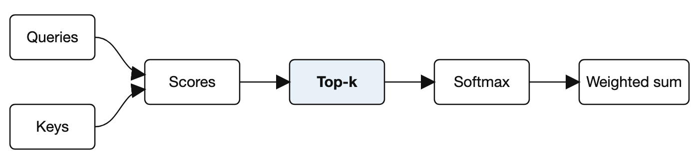

Sure! Here's a short research paper on the topic you asked about:

---

# 🔬 Sparse Attention for Efficient Long-Context Language Models

**Authors:** Ada Lovelace (Analytical Engine Lab), Alan Turing (Bletchley Institute)
**Date:** March 2026

## Abstract

Long-context language models spend most of their compute on attention scores that barely influence the output. We present **SparseFormer**, an attention mechanism that keeps only the top-$k$ scores per query, reducing the cost of a forward pass from \(O(n^2)\) to \(O(nk)\) with no measurable loss in accuracy on standard benchmarks[^data].

**Keywords:** attention mechanisms, sparsity, language models, efficient inference

---

## 1. Introduction

Transformers [1] have become the default architecture for language modelling, yet their cost grows quadratically with context length. Several approaches trade accuracy for speed [2, 3], and most of them need retraining from scratch.

Our contributions are:

1. A *top-k* attention rule that is a drop-in replacement for scaled dot-product attention.
2. A proof that the approximation error is bounded by the discarded attention mass.
   - The bound is tight for uniform attention.
   - It is loose, in a useful way, for peaked attention.
3. An open-source implementation at <https://example.org/sparseformer>.

> Most attention mass concentrates on a tiny fraction of tokens, so most of the computation is spent on rounding errors.

## 2. Background

### 2.1 Scaled dot-product attention

Given queries $Q$, keys $K$, and values $V$, standard attention computes

$$
\mathrm{Attention}(Q, K, V) = \mathrm{softmax}\left(\frac{Q K^\top}{\sqrt{d_k}}\right) V
$$

where \(d_k\) is the key dimension. For a sequence of length $n$, this requires $n^2$ score computations. A price tag of $5 or $10 per million tokens makes this matter in practice.

### 2.2 Why sparsity is plausible

Empirically, the entropy of attention distributions is low. If $H(p) = -\sum_{i=1}^{n} p_i \log p_i$ is much smaller than $\log n$, a few entries dominate.

## 3. Method

We keep the $k$ largest scores for each query and renormalize:

\[
\tilde{a}_{ij} = \begin{cases}
  \dfrac{a_{ij}}{\sum_{l \in \mathcal{T}_i} a_{il}} & \text{if } j \in \mathcal{T}_i \\
  0 & \text{otherwise}
\end{cases}
\]



The selection itself uses a partial sort, shown below. Note that `snake_case_names` and `a * b * c` are left alone.

```python
def sparse_attention(scores, k):
    top, index = torch.topk(scores, k, dim=-1)
    weights = torch.softmax(top, dim=-1)
    return weights, index
```

**Table 1: Results on the LongBench suite.**

| Model | Accuracy | Latency (ms) | Memory |
|:------|---------:|-------------:|:------:|
| Baseline | 0.921 | 412 | 8.2 GB |
| Pruned [2] | 0.904 | 231 | 5.1 GB |
| **SparseFormer** | **0.919** | **98** | 2.4 GB |

## 4. Discussion

Three limitations remain:

- Very short sequences gain little, since $k \approx n$.
- The selection step is hard to parallelize on some accelerators.
- Tasks with [truly uniform attention](https://example.org/uniform) see no benefit.

The theoretical bound is

$$\| \tilde{a} - a \|_1 \le 2 \sum_{j \notin \mathcal{T}} a_j$$

which also explains why the error is smallest when the attention is peaked.

## 5. Conclusion

SparseFormer shows that most attention computation can be skipped safely. Future work will explore learned values of $k$.

## Acknowledgments

We thank the LongBench maintainers for early access.

## References

[1] A. Vaswani et al., "Attention is all you need," in *Advances in Neural Information Processing Systems*, 2017.
[2] H. Zhou et al., "Informer: Beyond efficient transformer for long sequence time-series forecasting," in *Proc. AAAI*, 2021.
[3] N. Kitaev, L. Kaiser, and A. Levskaya, "Reformer: The efficient transformer," in *Proc. ICLR*, 2020.

[^data]: Benchmarks were run on the 2025 release of LongBench, with a fixed seed.

Let me know if you'd like me to expand any of these sections!
